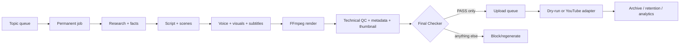

# AI YouTube Pipeline

A dependency-light, resumable Python 3 pipeline for producing YouTube-ready videos on Linux with FFmpeg. The checked-in default is deliberately safe: cloud AI, voice, visuals, thumbnails, publishing, and analytics are replaceable adapters; local mocks produce a complete test video without paid APIs; publishing defaults to `dry-run`.

## Safety invariant

No production upload callback can run unless `reports/final_checker.json` exists, parses, matches the strict schema, contains every mandatory check, has confidence at least 0.8, and has `decision: PASS`. Admission to `upload_queue.json` enforces the same rule independently. Missing, malformed, uncertain, `REGENERATE`, `BLOCK`, and unknown values fail closed.



State is stored atomically under `data/jobs/JOB_XXXXXX`; completed stages are skipped on resume. Each job also has a UUID, per-stage attempts, explicit transitions, errors, artifacts/publication fields, and an exclusive stale-aware lock. Large generated media and secrets are ignored by Git.

## Install and verify

Requirements: Python 3.11+, FFmpeg, and ffprobe. KDE Neon packages these as `ffmpeg` and `python3-venv`.

```bash
./scripts/setup.sh
./scripts/test.sh
./scripts/demo.sh
```

No third-party Python package is needed for the default local workflow. `setup.sh` is idempotent. The demo uses a temporary storage root and never contacts YouTube.

## Daily CLI usage

```bash
.venv/bin/python -m src.cli add-topic "How Black Holes Work"
.venv/bin/python -m src.cli list-topics
.venv/bin/python -m src.cli run-next
.venv/bin/python -m src.cli status-all
```

Other commands: `run-job JOB_000001`, `resume`, `validate`, `render`, `final-check`, `queue-upload`, `publish`, `cleanup JOB_000001` (dry-run by default), `cleanup JOB_000001 --execute`, `archive`, `analytics`, and `doctor`. Forced stages still rerun downstream validation in the normal orchestrator sequence; completed stages otherwise remain untouched.

## Configuration and providers

Edit `config/config.json` for non-secret settings or copy `.env.example` to `.env`. Environment values override provider/storage/publish fields. Defaults use the `mock` research, tone-audio, solid-image, and thumbnail providers at 640x360 to minimize RAM/CPU. Mock research explicitly records that it has no externally verified citations; it must never be presented as sourced research.

Provider contracts live in `src/providers.py` and subsystem base modules. A real provider should return the same structured artifacts and preserve uncertainty/source data. Cloud storage implements the interface boundary but requires a vendor adapter. The YouTube analytics class is separate from publishing.

## Production YouTube authorization

Production upload is intentionally not authenticated or enabled by this repository. Set `AIYT_PUBLISH_MODE=production`, `YOUTUBE_CLIENT_SECRETS` and `YOUTUBE_TOKEN_FILE` to protected local paths, install a Google API adapter, and supply its upload callback to `YouTubePublisher`. OAuth client JSON and tokens are ignored. The publisher still reloads and validates the Final Checker report itself. Start with `privacy_status: private`.

## Storage, cleanup, and recovery

Set `AIYT_STORAGE_ROOT` to a local/external mounted directory. Job media is streamed through FFmpeg rather than loaded into RAM. `resume` restarts incomplete jobs from their first incomplete stage. Cleanup eligibility is set only after a real publication and defaults to publication plus six days. Cleanup rejects mismatched job IDs, traversal, root targets, and symlinks; its default is audit-only. It never removes archived/final script, metadata, checker reports, checksums, publication record, final thumbnail, or final video.

## Scheduling

Templates under `systemd/` are user units and are not enabled automatically. After reviewing paths:

```bash
mkdir -p ~/.config/systemd/user
cp systemd/* ~/.config/systemd/user/
systemctl --user daemon-reload
systemctl --user enable --now ai-youtube-worker.timer
```

The worker inherits dry-run defaults. Cleanup/analytics timers currently perform safe readiness/audit actions; destructive cleanup and production upload are never automatically enabled.

## Troubleshooting and security

Run `python -m src.cli doctor`. Inspect `job.json`, `reports/technical_qc.json`, and `reports/final_checker.json`. Never commit `.env`, OAuth JSON, tokens, logs, or job media. Paths are passed to FFmpeg as argument arrays—not evaluated shell strings. JSON is parsed without `eval`. Network/provider retry work must remain bounded. See `PRODUCTION_READINESS.md` for honest subsystem status and limitations.

